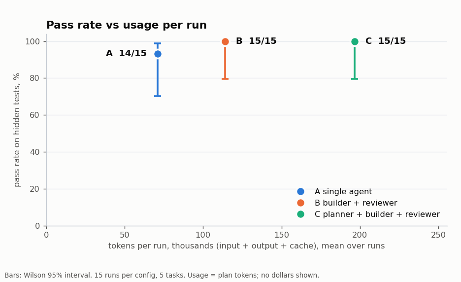
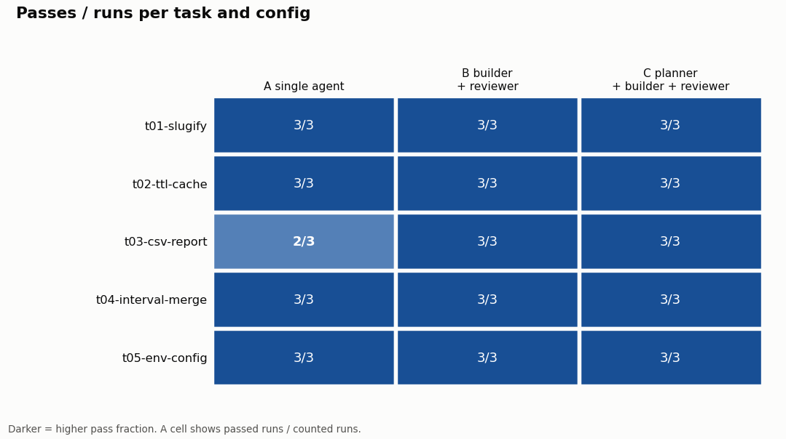
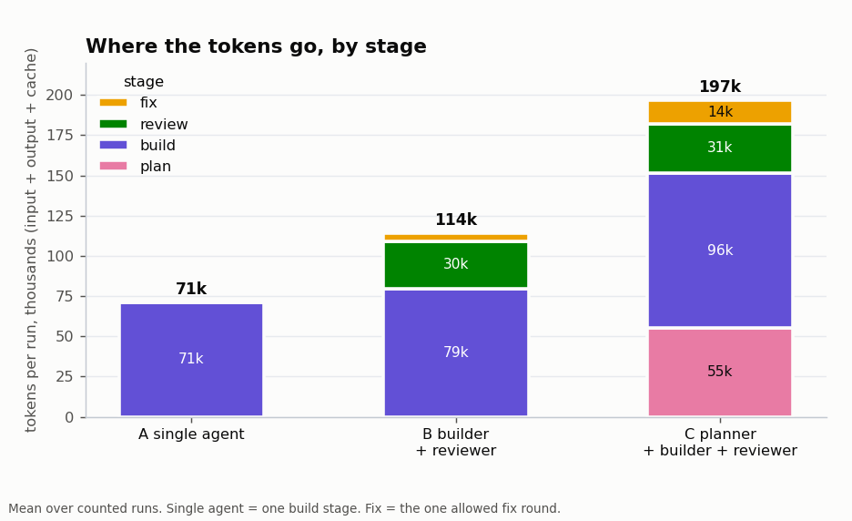

# agent-team-evals

Does a team of Claude agents (planner, builder, reviewer) write better code than one agent, and
what does it use? This harness runs the same coding tasks through three setups and measures
pass rate on hidden tests, usage (tokens and turns), and wall-clock time.

| Config | Setup |
|---|---|
| A | one headless Claude Code agent (`claude -p`) |
| B | builder + read-only reviewer, one round of fixes |
| C | planner → builder(s) → reviewer → one fix round |

**Status:** the 45-run pilot, the Sonnet 5.5 part of a second study and its model matrix are done. See
[DESIGN.md](DESIGN.md) for how and why, and [TASKS.md](TASKS.md) for what's next.

## Second study (Sonnet 5.5, interim)

11 tasks screened from 28 because a single agent can fail them, 5 runs per task and setup, 2026-11-01.

| setup | passed | tokens / run | sign test against A |
|---|---|---|---|
| A one agent | 15 / 55 | 166,401 | |
| AS fresh self-check | 11 / 55 | 265,973 | p = 0.29 |
| B builder + reviewer | 11 / 55 | 257,137 | p = 0.22 |

No setup beat A, and the gaps can't be told apart from chance. The reviewer approved 46 of 55 runs, 35 of which
failed, and all 9 runs it flagged still failed. Six of the 11 tasks failed in every run, and some hidden tests are
debatable. Parallel work and repos beyond about 3,000 lines are untested. Sweeps, per-task tables, a sensitivity score and
limits are in [docs/study2-main-sweep.md](docs/study2-main-sweep.md).

## Model matrix (interim)

The same 11 tasks, 3 runs per task and setup, 132 runs and 45.5M tokens, 2026-11-01. The Sonnet rows are runs 1 to 3
from the sweeps above, not rerun.

| setup | passed | tokens / run | sign test against one Sonnet |
|---|---|---|---|
| one agent, Sonnet | 8 / 33 | 169,668 | |
| one agent, Opus | 6 / 33 | 163,481 | p = 0.69 |
| Sonnet builder, Sonnet reviewer | 6 / 33 | 263,370 | |
| Sonnet builder, Opus reviewer | 4 / 33 | 364,902 | p = 0.22 |
| Haiku builder, Sonnet reviewer | 4 / 33 | 467,873 | p = 0.34 |
| one agent, Haiku | 1 / 33 | 381,830 | p = 0.04 (about 0.16 adjusted) |

No model or mixed team beat one Sonnet agent. On the decision tasks, all 10 runs that covered every decision passed and
none of the other 38 did. Details and limits are in [docs/study2-model-matrix.md](docs/study2-model-matrix.md).

## Pilot results

Sweep `20261029T220931Z` (`results/20261029T220931Z.jsonl`): 5 hand-written tasks x configs A, B, C x 3
runs = 45 runs, all on Claude Sonnet 5.5, on a Claude Max subscription (no per-token billing). All 45
runs count: none was rejected, retried, flagged for isolation, leaks or read-only violations.

| config | runs | pass rate (95% CI) | tokens / run | turns / run | median wall time | fix round ran |
|---|---|---|---|---|---|---|
| A single agent | 15 | 93% (70%-99%) | 70,947 | 8.7 | 20.6 s | n/a |
| B builder + reviewer | 15 | 100% (80%-100%) | 114,189 (1.61x A) | 12.5 | 36.5 s | 7% |
| C planner + builder + reviewer | 15 | 100% (80%-100%) | 196,607 (2.77x A) | 23.3 | 60.8 s | 20% |

Tokens count input, output and cache reads and writes, summed over every stage. The whole sweep used
5,726,145 tokens, 667 turns and 35 minutes of agent time. Passes per task (of 3 runs each): every cell is
3/3 except config A on `t03-csv-report`, 2/3.



*Pass rate against mean tokens per run, one point per config (bars: 95% Wilson interval, 15 runs each).
The intervals overlap almost completely: on these tasks the data cannot separate the configs on pass rate,
only on usage.*



*Passed runs out of three, per task and config. Only one cell is not 3/3: config A on the multi-file
`t03-csv-report`.*



*Where the tokens go. Planning (55k tokens per run) is the largest extra cost of config C; the reviewer
costs about 30k tokens per run in both B and C.*

Compared task by task (5 tasks; the interval comes from resampling tasks, so with so few it is crude;
`python -m ate report` prints it):

| pair | pass rate difference | tokens per run difference |
|---|---|---|
| B vs A | +7 points (interval +0 to +20, so it touches zero) | +43,241 (+35,087 to +51,301) |
| C vs A | +7 points (interval +0 to +20, so it touches zero) | +125,660 (+92,156 to +188,947) |
| C vs B | 0 points (0 to 0) | +82,419 (+45,990 to +143,515) |

The +7 points for both teams comes from a single run: config A's one failure. The usage differences are
large and clear; the pass-rate differences are not.

What the pilot does and does not show:

- **No evidence yet that a team passes more often.** The only failure in 45 runs was config A on t03,
  run 1: it printed `0` instead of `0.00` for a group with no values (requirement 4). The pass-rate
  intervals overlap almost entirely, and four of five tasks were solved by every run of every config.
  These tasks are too easy to separate the configs.
- **What the team costs is clear.** B used about 1.6x A's tokens and C about 2.8x, with 1.8x and 3.0x
  the wall time. The gap grows with task difficulty: on the multi-file t03, A used about 123k tokens
  per run, B 170k and C 374k.
- **The reviewer did catch real problems.** It asked for changes in 4 of the 30 B and C runs
  (t01 once, t03 three times), each pointing at a concrete defect, and the fix round turned all four into
  passes. In one of them (t03, config C, run 2) it flagged the same `0` versus `0.00` bug that sank A's
  one failure. That is suggestive, not proof: the same builder run might have passed without the review.
- **The planner mostly wasn't needed.** It chose a single subtask in 12 of 15 C runs, so C's extra cost
  is mostly the planning stage itself.

**Follow-up: nine more tasks, still too easy.** To get tasks that could separate the configs, nine larger
tasks were added (`t06` to `t14`: 117 to 323 lines of reference solution, 6 to 12 numbered requirements, 22 to
66 hidden tests each). One run of config A on each passed all nine on its first try (854,488 tokens in total,
115 turns, 351 seconds of agent time), so they do not separate the configs either; the pilot above still
covers only `t01` to `t05`. The only task any run has ever failed is a long spec with many small formatting
rules (`t03`), so the next batch leaned on volume and precision instead of size alone.

**Second follow-up: four much harder tasks, also passed.** `t15` to `t18` have 25 to 36 numbered requirements,
400 to 520 lines of reference solution and 88 to 134 hidden tests each, with many exact output rules (one is
a hunt for 7 planted bugs). One run of config A on each passed all four on its first try (sweeps
`20261030T023845Z`, `20261030T024137Z`, `20261030T024402Z`: 1,035,437 tokens in total, 131 turns, 376 seconds of
agent time). So a single Sonnet 5.5 agent has passed all 13 tasks written to be hard. A fully specified task,
however long, gives a reviewer or planner little to add.

**Third follow-up: a weaker model passed too.** One run of config A with Haiku 5.5 on `t15` to `t18` and `t12`
(sweep `20261030T044006Z`) passed all five: 3,149,064 tokens, 142 turns, 863 seconds of agent time. On `t15` to `t18`
Haiku used 3,073,469 tokens against Sonnet's 1,035,437 (about 3x) and still needed no reviewer. With no single-agent
failures to fix, a team sweep on these tasks would measure only its extra usage.

**Fourth follow-up: under-specified tasks, also passed.** `t19` to `t21` give a short, realistic request and
leave the rules in the starting repo's own docs, config and code. One Sonnet 5.5 run of config A on each (sweep `20261030T165840Z`) passed all three: 318,037 tokens,
36 turns, 112 seconds of agent time. Rules written anywhere in a small repo are found. An overview page with
all results is at https://krisrchesney.github.io/agent-team-evals/.

Caveats: 5 tasks and 3 runs per task and config, one model, teams orchestrated by the harness in a
fixed order (not by the model), and tasks written for this project. Differences under about 15 points
of pass rate are not detectable at this size. Token counts are exact; the dollar figure in the raw
records (`api_equiv_usd`) is Claude Code's API-price estimate, not a charge.


## Try it (no API calls, no plan usage)

```bash
python -m ate list                       # tasks, configs, where the claude CLI is
python -m ate validate                   # each task: hidden tests fail on the start code, pass on the reference
python -m ate run --dry-run --reps 1     # whole pipeline with a fake CLI (no plan usage)
python -m ate run --dry-run --oracle --reps 1   # same, fake builders apply the reference solution
python -m ate report results/<sweep>.jsonl
python scripts/check.py                  # everything above as one health check
```

Real runs use your Claude Pro/Max subscription (plan usage, no per-token billing) through a clean
profile that holds only a login. Turn off "extra usage" in claude.ai settings first, then:

```bash
python -m ate auth                       # signed in? if not, prints the one-time login command
python -m ate run --tasks t01 --configs A --reps 1 --run-cap 0.5 --max-total-api-equiv 0.5 --yes
```

`ate` finds the CLI itself: `CLAUDE_BIN`, then `claude` on PATH, then the newest bundled copy under
`%LOCALAPPDATA%\Packages\Claude_*\LocalCache\Roaming\Claude\claude-code` (the real path in an ordinary
PowerShell). `ate auth` prints the path it resolved.

To run a whole sweep unattended, for example overnight, use the wrapper. It waits out a usage limit and
resumes the same sweep, and stops on any other halt (leak or auth check, sweep cap):

```bash
powershell -File scripts\run_sweep.ps1 -DryRun                      # rehearsal, no plan usage
powershell -File scripts\run_sweep.ps1 -Tasks "t01,t02,t03,t04,t05" -Reps 3   # the pilot
```

A run that hits your usage limit stops the sweep; continue it later with `--resume <sweep_id>`.

Python 3.12, standard library only. Worktrees and transcripts go to `D:/ate-work`
(`work_root` in configs/defaults.json).

License: [MIT](LICENSE).
